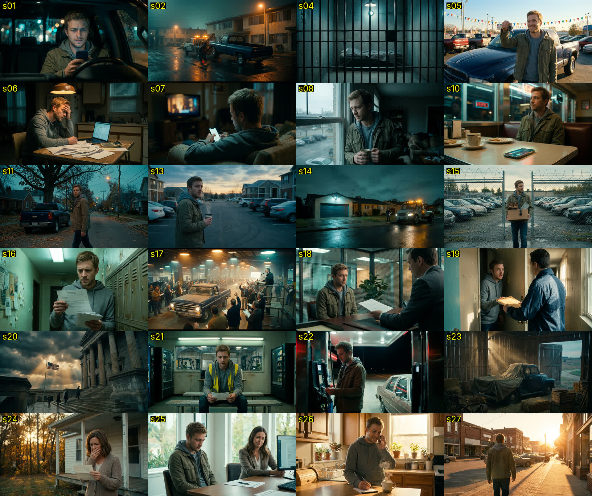

# The Money Trail — Channel Guide

**Format:** English, US-focused personal finance. Every episode answers one
"What happens if…?" money question by following one American character through
the whole story, step by step, until the very end.

**Tagline:** *Follow the money. All the way to the end.*

**Look:** cinematic and photoreal, like a short film: real American places
(dealership, apartment, bank, courthouse, jail, gas station, diner), teal-and-amber
grade, film grain, letterbox bars, slow camera moves. Clean motion graphics on top
(day stamps, cards, gauges, math). This is the main difference from the competitor
(Legal Lens), whose style is a flat cartoon character on a plain background.

---

## 1. The episode structure (taken from the competitor's best video)

The Legal Lens credit-card video (1.2M views) follows this exact skeleton. Keep it
for every episode. Only the topic, numbers and places change.

| # | Beat | Length | What it does | Ep1 example |
|---|------|--------|--------------|-------------|
| 1 | **Hook question** | 0:00–0:15 | Ask the "What happens if you just…" question, then the 3 scary questions the viewer has (police? lose X? jail?). | "Do they come in the middle of the night? Can the police get involved?" |
| 2 | **Promise** | 0:15–0:25 | "Today we follow one ___ all the way to the end, step by step." + title card. | One missed car payment → the end |
| 3 | **Meet the character** | 0:25–0:45 | Name, age, city, the exact numbers. Then the moment things go wrong. | Tyler, 27, Columbus OH, $22,000 / 6 yrs / $450 a month. Hours cut, picks rent. |
| 4 | **Day 1** | ~25 s | "Honestly? Not much happens." Small consequence. "If he pays now… but he doesn't." | Grace period, late fee, texts |
| 5 | **Day 30** | ~30 s | First big moment (credit bureaus, score drop) + one hidden detail. | Equifax/Experian/TransUnion, contract default clause |
| 6 | **Day 60–90** | ~20 s | It gets worse; character keeps ignoring it. | Daily calls, hides the truck around the corner |
| 7 | **The big event** | ~35 s | The scene everyone fears, told cinematically. | 3:12 AM tow truck, empty parking spot |
| 8 | **"Here's something most people don't know"** | ~30 s | The viewer's rights / the rules the other side must follow. | Repo agents can't breach the peace |
| 9 | **Myth bust** | ~35 s | "So it's over, right? Not even close." | Notice of sale, redeem vs reinstate |
| 10 | **The math** | ~40 s | Concrete numbers on screen. The shock number. | $19,000 − $11,000 + $1,500 = **$9,500** owed for no truck |
| 11 | **Escalation** | ~30 s | Collections → debt buyer → lawsuit → default judgment. | Served at the door |
| 12 | **Tools #1, #2 (#3)** | ~25 s | What a judgment allows. | Wage garnishment (25% cap), bank levy (card declined) |
| 13 | **The big question** | ~45 s | "Can he go to jail?" Answer **No**, then "But there's a catch. Two, actually." | Ignoring a court order; hiding collateral can be a crime |
| 14 | **One more twist** | ~25 s | Something almost nobody sees coming. | Mom co-signed, so she owes it too |
| 15 | **How long it lasts** | ~15 s | Credit report years / statute of limitations. | 7 years |
| 16 | **Rewind recap** | ~35 s | "Let's rewind and watch the whole thing." Fast timeline. "All from one moment when…" | Animated timeline |
| 17 | **What to do instead** | ~25 s | "The earlier you act, the more options you have." 3–4 concrete steps. | Deferral, refinance, sell it yourself, voluntary surrender |
| 18 | **Disclaimer** | ~15 s | Laws vary by state. General information, not advice. Talk to a professional. | — |
| 19 | **Sign-off + next episode** | ~10 s | "This is The Money Trail…" + tease the next topic. | Student loans |

**Rules that make it work**

- One character, one story. Always "he/Tyler", never "you", in the middle part.
- Specific numbers every 20–30 seconds ($450, day 30, 25%, 7 years).
- Each beat ends on a small cliffhanger: "But Tyler doesn't pay." / "It doesn't." / "Not even close."
- 8–9 minutes, about 1,350–1,450 words.
- Say "in most states / in many states / generally". Facts must be checkable; keep the disclaimer.

## 2. The character: Tyler

- **Tyler**, 27, from Columbus, Ohio. Regular working guy (warehouse shifts).
- Short messy light-brown hair, light stubble, friendly tired eyes.
- Faded olive-green work jacket over a grey hoodie, dark jeans, tan work boots.
- Drives a dark blue used pickup truck.
- Supporting cast: **Mom** (mid-50s, cardigan, white wooden house in small-town Ohio).

Tyler is the recurring face of the channel. Every episode is a new "What happens if…"
in his life, so viewers get attached to him.

**Keeping his face consistent:** the reference sheet lives on the ElevenLabs flow
"The Money Trail – Ep1 Car Loan" as the node **Tyler reference**. Generate every
Tyler scene with `gemini-3-pro-image` with that node wired in as a reference,
and start the prompt with *"the man from the reference image (same face, hair,
stubble, olive work jacket over grey hoodie)…"*.

## 3. Location library (already generated)

| File | Place | Reuse for |
|------|-------|-----------|
| s01 | Tyler in his truck at night, phone glow | hooks, worry |
| s02 | Tow truck at 3 AM, apartment lot | repo, night threat |
| s04 | Empty jail cell | "can you go to jail?" |
| s05 | Used-car dealership, holding keys | buying anything, "remember when…" |
| s06 | Kitchen table with bills at night | money is tight |
| s07 | Couch with phone | notifications, emails, collectors |
| s08 | Apartment window, overcast morning | reflection, credit score |
| s10 | Diner booth, phone buzzing | ignoring calls |
| s11 | Side street at dusk, walking away from truck | avoiding / hiding |
| s13 | Empty parking spot, coffee in hand | the morning after |
| s14 | Locked garage, tow truck at curb | rights / rules |
| s15 | Impound lot, box of belongings | after a repo |
| s16 | Mailbox lobby, reading a letter | notices, letters |
| s17 | Wholesale car auction | auctions |
| s18 | Bank office with loan officer | banks, loans, math |
| s19 | Process server at the door | lawsuits |
| s20 | County courthouse | court, judges |
| s21 | Warehouse break room, paystub | paycheck, garnishment, taxes |
| s22 | Gas station at night, card declined | bank levy, frozen account |
| s23 | Truck hidden in a barn | hiding assets |
| s24 | Mom on porch with letter | family, co-signers |
| s25 | Leasing office, rejected | credit consequences |
| s26 | Sunny kitchen, on the phone | "what to do instead" |
| s27 | Small-town main street, golden hour | endings |

**Prompt style suffix for new places:**
`Photorealistic, ARRI Alexa 35mm, shallow depth of field, teal-and-amber grade, soft film grain, moody American atmosphere. 16:9. No readable text, no logos, no watermarks.`

## 4. Production workflow (per episode)

1. Write the script on the 19-beat structure → `episodes/epXX-topic/narration.txt`.
2. Narration: ElevenLabs `eleven_v4`, voice **"Ryan – American Documentary Narrator"**,
   in 4 parts of about 2 minutes each.
3. Word timings: transcribe each part with `eleven_scribe_v1`, merge into
   `money-trail-video/src/words.json` (0.6 s gap between parts).
4. New scene plates as needed (reuse the library first) → `money-trail-video/public/scenes/`.
5. Edit the shot list and overlays in `money-trail-video/src/Episode.tsx`
   (everything is timed with `W(wordIndex)`).
6. Render and master (see `money-trail-video/README.md`).
7. Thumbnails: `Thumb-A` / `Thumb-B` stills.

## 5. Next episode ideas (same formula, same Tyler)

1. What happens if you never pay your student loans?
2. What happens if you stop paying rent?
3. What happens if you don't file your taxes?
4. What happens if you max out every credit card?
5. What happens if you ignore a medical bill?
6. What happens if you bounce a check / overdraft your account?
7. What happens if you co-sign for a friend and they stop paying?
8. What happens if you stop paying your mortgage?
9. What happens if you get caught with no car insurance?
10. What happens if you file for bankruptcy?
